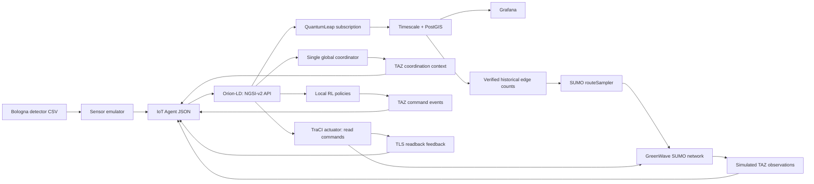

# BoMoDT Federated — FIWARE and Streamlit

Two English control rooms for the same Bologna mobility experiment:

- **Monolithic:** one city-wide FIWARE stack and one centralized RL runtime.
- **Federated:** one isolated FIWARE stack per trained TAZ, local RL workers and
  one global coordinator.

Both use the **GreenWave_HRL road network** and the same exported training
profiles. The original BoMoDT and GreenWave_HRL checkouts remain unchanged. This
repository adapts their component roles into a common implementation so the map,
scenario and control law can be held constant while deployment changes.

## Start the dashboards

Use **Python 3.11** as the reference interpreter (also recorded in
`.python-version`). Python package metadata requires Python 3.11 or newer;
newer interpreters are not the reference environment for RL experiments.
This choice does not change the live-integration validation limits below.

From this repository root, with Python 3.11, Docker Compose and SUMO installed:

```bash
python3.11 -m venv .venv
source .venv/bin/activate
python -m pip install --upgrade pip
python -m pip install -r requirements.txt
python -m pip install --no-deps -e .
streamlit run dashboards/monolithic.py --server.address 127.0.0.1 --server.port 8501
```

`requirements.txt` contains the Python runtime dependencies, including Streamlit,
psycopg and the RL/SUMO bindings. `pyproject.toml` reads that same file, so
`python -m pip install -e .` remains an alternative installation command.
Docker Compose and the SUMO executable are external prerequisites, not pip
packages. The requirements are not a fully validated version lock; freeze the
working environment after the live FIWARE and checkpoint tests pass.

In a second terminal, using the same environment:

```bash
streamlit run dashboards/federated.py --server.address 127.0.0.1 --server.port 8502
```

Open `http://localhost:8501` and `http://localhost:8502`. Use **Start services**
in the sidebar before an emulation or a simulation. The normal workflow has one primary action
per stage; technical inspection and logs are collected in **Diagnostics**.

1. **City emulation:** choose a source dataset, any available starting date/hour
   and a duration. Timed readings have variable interval counts, exact hourly
   totals and a configurable playback speed. Training profiles do not constrain
   these controls. The source clock can cross midnight into the next date.
2. **FIWARE & Grafana:** select a replay, source period and TAZ. Grafana displays
   interval crossings, cumulative hourly counts and finalized measurements.
   Choose **Simulation control** to inspect persisted observations, coordination,
   commands and feedback from an active-control run.
3. **SUMO scenarios:** select a verified source period and prepare routes. Demand
   settings and optional RL profile selection live here, independently of emulation.
4. **Simulation:** choose No agents, Local agents or Local agents + coordinator,
   optionally enable **Open SUMO GUI**, and press **Start simulation**.
5. **Footprint & latency:** inspect emulation/simulation records, compare labelled
   monolithic/federated operations and download CSV, JSON and PNG/SVG plots as ZIP.
6. **Diagnostics:** service health, container status/logs, broker entities,
   manual Compose generation and detailed background-job logs.

Operations run in background jobs, so Streamlit reruns do not relaunch them.
A compact operation status and cancellation control remain below the tabs.
Use **Refresh workspace** after completion to reload replay/scenario/report lists.
Stopping services preserves database volumes.

**Validation:** both Streamlit applications are covered by AppTest. Timed real
FIWARE replays pass in monolithic mode across midnight and in federated mode at
14:00 (outside the selected training hours). SUMO GUI runs have completed without
agents and with local RL, using the canonical city network. Reports contain real
resource samples and exported plots. See [validation](docs/validation.md) for
artifacts and limits; these smoke runs are not a scientific architecture benchmark.
Active FIWARE simulations have also completed six control cycles in both modes,
with matching actions and coordinator prices on the same saved scenario.

## Complete data path



Scenario generation never substitutes the source CSV or the local SQLite shadow
for persisted FIWARE data. The CSV is the emulator's input. A replay becomes
`verified` only after all expected measurements can be read back from the
QuantumLeap-owned Timescale table and match their source identity/count. Each
replay gets a fresh FIWARE tenant to avoid mixing repeated experiments. Original
observation timestamps are preserved in UTC; the UI selects hours in Europe/Rome.
Ambiguous/nonexistent daylight-saving hours are rejected because the source CSV
cannot disambiguate them.

Orion-LD 1.5.1's NGSI-v2 path rejects apostrophes even with TextUnrestricted.
Street-name metadata therefore travels as UTF-8 hex in `roadNameHex`; Python
readers and Grafana decode it to the exact original label. Counts, timestamps,
identifiers and source files are unchanged. Each source hour is verified before
advancing. Missing notifications can trigger up to three repair batches through
the same IoT Agent path; a fresh `deliveryId` changes per attempt, while `sampleId`
and source time stay stable. Readers and charts deduplicate repeated samples.
Repair attempts and per-hour barriers are recorded in replay artifacts.

The diagram combines initial scenario preparation and the simulation control
loop. During simulation, each TAZ's observations, coordinator context, commands
and feedback traverse IoT Agent and Orion as distinct event kinds; QuantumLeap
persists them in Timescale. Consumers check the current sequence, and the complete
barrier is verified in history before SUMO advances. In monolithic mode these
events use one city stack; in federated mode they use the corresponding TAZ stack.

Timescale is queried directly, as in BoMoDT's DataManager. This avoids relying on
QuantumLeap API querying features that vary by backend/version. Grafana reads the
same history table. IoT Agent southbound HTTP acceptance and historical persistence
are distinct milestones, recorded separately.

## FIWARE deployment

Each stack contains **Orion-LD, MongoDB, IoT Agent JSON, QuantumLeap,
Timescale/PostGIS, Redis and Grafana**. The wire contract uses Orion-LD's NGSI-v2
compatibility API for the IoT/QuantumLeap chain; it is not an NGSI-LD data-model
migration. This makes the original component roles explicit and consistent.

The monolith has seven service containers. Full federation has **77 service
containers** across eleven private networks. Database volumes, brokers, IoT
registries, PostgreSQL schemas and Grafana instances are isolated per TAZ. There
are no fixed container names and no shared city database hidden behind tenant
headers. Resource use can therefore be substantial.

Ports are bound to localhost and are disjoint between the dashboards:

| Service | Monolith | Federated TAZ at index i |
|---|---:|---:|
| Orion-LD | 11000 | 12000 + 10i |
| IoT provisioning | 11001 | 12001 + 10i |
| IoT measurements | 11002 | 12002 + 10i |
| QuantumLeap | 11003 | 12003 + 10i |
| Grafana | 11004 | 12004 + 10i |
| PostgreSQL | 11005 | 12005 + 10i |

TAZ order is `F, B, H, T, O, P, Q, D, G, M, L`. These are the areas covered by the
available processed detector data and trained policies; the network also includes
other TAZ polygons. No untrained policy is invented for those other areas.

`configs/fiware-images.json` centralizes image references. Most defaults follow
the original BoMoDT deployment; IoT Agent JSON has an explicit release instead of
`latest`. Some upstream image references are moving tags. Record resolved image
IDs/digests and pin them before collecting benchmark results. The stack uses
local research credentials (`postgres` / `research`; Grafana admin password
`research`), with anonymous Grafana viewer access for iframe embedding.

Generated Compose/provisioning files live in ignored `deployments/`. Generate them
on the target checkout to resolve its absolute volume paths:

```bash
python -m federation.fiware stack generate --mode monolithic
python -m federation.fiware stack generate --mode federated
python -m federation.fiware stack up --mode monolithic
python -m federation.fiware stack up --mode federated
```

PostgreSQL's first-run initialization enables Timescale and PostGIS in the
`quantumleap` database. Initialization does not modify existing volumes. There is
no automatic database-volume deletion command in either dashboard.

## Scenarios and agents

The supplied normalized detector datasets were copied from GreenWave_HRL and
contain dates from 2025 and 2026. No-agent scenarios can use any available date
and unambiguous hour. RL deployment requires the profile's matching day type and
one of its training hours:

| Profile | Day type | Training hours | Local price adapter |
|---|---|---|---|
| `200_weekdays_8_17` | Weekdays | 8, 17 | zero_anchored_v2 |
| `200_weekdays_10_11` | Weekdays | 10, 11 | legacy |
| `200_weekends_9_20` | Weekends | 9, 20 | legacy |
| `200_weekends_12_19` | Weekends | 12, 19 | legacy |

Hour pairs are discrete training hours, not continuous daily time windows. Each
scenario covers one simulated hour. Counts constrain `routeSampler`; the target
vehicle count follows the saved training demand profile and selected multiplier,
not the sum of detector passages. Multiple sensors on one edge are combined with
an explicitly recorded rounded-mean rule. Inspect `mismatch.xml`: fitted routes
are an estimate and are not guaranteed to match every count exactly.

Eight best checkpoints (local-only and coordinated for each profile) are included
with SHA-256 checksums. Local observations preserve the upstream 304-feature ABI,
six padded group-action slots, masks, normalization and TLS/group ordering.
Coordinated locals receive three additional price features. The monolith reuses
one in-memory local policy across TAZs; federated workers own independent copies.
Checkpoint-specific adapter type/scale and metric clipping are retained. The
stored reward combines CO2 and NOx with weights 0.5/0.5. Training remains in
GreenWave_HRL; this repository focuses on inference and experiments.

The **no-agent** button runs SUMO's normal TLS programs without loading Torch,
policies or the coordinator. It differs from the legacy `--control fixed` CLI,
which still computes local inference before replacing its actions with zero.

The federated RL runtime defaults to one authoritative city SUMO instance and
local inference workers. An optional checkbox adds a separate full-city SUMO
replica per TAZ: **12 SUMO instances** in total, all replaying the same action
barrier. This is independent simulation by replication, not territorial network
partitioning or boundary vehicle transfer. The latter remains future work.

Both dashboards list the same prepared scenarios. Reuse one immutable scenario
for a paired monolithic/federated comparison. Network and route hashes are checked
before each run. Original BoMoDT's map is intentionally not used in these new
execution modes; original source files are preserved for provenance.

## Timed emulation and GUI

Source counts have hourly resolution. For example, 150 passages are distributed
across 60 one-minute reporting intervals with reproducible variable rates. Their
sum remains exactly 150. Each report sends the interval increment, cumulative
count and source time through the real IoT Agent/FIWARE path. These intra-hour
arrivals are synthesized, not observed individual vehicle trajectories. The
historical reader uses only finalized hourly totals when reconstructing SUMO
scenarios, so intermediate cumulative values are not double-counted.

```bash
python -m federation.fiware emulate --mode federated \
  --source data/processed_traffic_flow.csv \
  --start-time 2025-01-01T14:00 --duration-hours 2 \
  --temporal --speed 60 --interval-seconds 60 --seed 42
```

`--speed 1` is real time; `60` targets one wall minute per source hour. HTTP and
persistence work can make accelerated playback run late; scheduled and actual
send times are recorded. Intervals are 60/120/300/600 source seconds. Starts are
hour-aligned because the CSV contains hourly observations. Required source dates
must exist, including the next day for a midnight crossing. Without `--temporal`,
legacy bulk ingestion is still available. `--hours` and `--date` remain supported.

Enable GUI for either no-agent or learned-policy runs:

```bash
python -m federation.fiware simulate --mode monolithic \
  --scenario scenarios/matched-scenario --control local \
  --gui --gui-delay 20 --output experiments/local-with-gui
```

SUMO opens a desktop window on the host running Streamlit; it is not a browser
video stream. It starts automatically and closes at completion. GUI delay is in
wall milliseconds per simulation step, is captured in metadata, and affects
footprint/simulation latency. Optional replicas remain headless; only the
authoritative city gets a window. See [SUMO GUI documentation](https://sumo.dlr.de/docs/sumo-gui.html).

## Active FIWARE during simulation

Simulations now use FIWARE observations, coordinator context, commands and
feedback every 600 simulated seconds, with a terminal snapshot at 3600 seconds.
Start the selected deployment before running. The no-agent path publishes
telemetry/TLS state without policy commands. Add `--offline` only for the legacy
baseline. See [the control-loop and measurement contract](docs/closed-loop.md).

## Compare monolithic and federated

The deployments are independent: the monolith has **7 containers**, including
one Orion and one IoT Agent, while the federation has **77 containers**, a full
seven-service stack for each of eleven TAZs. Their ports, networks and database
volumes are separate. Both Streamlit dashboards may stay open, but for measurements
run **one architecture at a time** and stop the unused deployment. Closing a
browser or Streamlit does not stop its containers.

### Compare simulation, control latency and resources

1. Open the monolithic dashboard at `http://localhost:8501`. Stop federated
   services if running, then press **Start services** in the monolithic dashboard.
2. In **City emulation**, choose an available source date/hour and complete a
   replay until it is **verified**. For a simple learned-control example, use
   `2025-01-01`, hour `08:00`, and profile `200_weekdays_8_17` in the next step.
3. In **SUMO scenarios**, prepare **one** scenario from that replay. Record its
   full saved name. Emulation alone does not create a scenario.
4. In **Simulation → Prepared scenario**, select it and choose
   **Local agents + coordinator**. Keep **Open SUMO GUI**, additional full-city
   replicas and **Offline baseline** all off. Press **Start simulation**.
   The selected FIWARE services must stay running throughout the simulation.
5. Wait for completion and download its ZIP in **Footprint & latency**. Then
   press **Stop services** in the monolithic dashboard.
6. Open the federated dashboard at `http://localhost:8502`, press **Start services**,
   and go directly to **Simulation**. Select the **exact same saved scenario**
   and controller, with the same GUI/replica/offline settings, and run it.
   Do not regenerate the scenario or repeat source emulation for this comparison.
7. In **Footprint & latency** in either dashboard, keep **Measurements to evaluate → Simulations**, select **both architectures**
   and the two matching **Simulation** reports. Compare resource scopes and
   latency distributions, then download both ZIPs. Use **Prepare report and
   plots** if exports are absent from an existing run.
8. Repeat matched pairs, alternating architecture order. Five pairs are a useful
   starting point; choose more repetitions based on observed variability. Six
   control cycles from one run do not establish architecture superiority.

Saved scenarios are shared between dashboards and appear under **Simulation**.
The **SUMO scenarios** tab instead lists the current architecture's verified
replays for preparing new scenarios. A `monolithic` or `federated` suffix in a
scenario name records where it was prepared; it does not restrict execution.
Use **Refresh workspace** if a newly prepared scenario is missing from the list.

Both runs simulate one hour: six control cycles at 600-second intervals and a
terminal snapshot at 3600 seconds. Use the same controller in both modes;
comparing No agents with Local agents + coordinator changes the control law as
well as the architecture. Old offline results are a separate baseline and must
not be paired with the new active-FIWARE runs.

| Comparison | What to inspect |
|---|---|
| Transmission and consumption | Observation/coordination/command/feedback HTTP acceptance, publish-to-read and consumer broker-read times |
| Actuation and durability | Command-to-TLS-readback, control-history verification and closed-loop latency |
| Complete execution | Physics advance and full-cycle latency, operation wall time |
| Resource cost | Application/SUMO and FIWARE CPU, sampled CPU seconds, memory peaks, disk I/O and container-interface traffic |

Resource capture covers runtime startup, provisioning, simulation/control and
teardown, including local workers, the coordinator, SUMO and the originating
Streamlit server for dashboard jobs. FIWARE containers are sampled separately.
Earlier container startup, source emulation and route preparation are separate
phases. HTTP/publish-to-read latencies include processing and polling on this
single host; they do not isolate pure network propagation. Keep GUI, logging,
launch method and workloads identical. Sampling and memory-accounting limits
are detailed in [the measurement contract](docs/closed-loop.md).

### Compare initial source-data ingestion separately

Repeat **City emulation** in each architecture with identical dataset, source
start, duration, temporal/bulk mode, speed, reporting interval, transmission delay
and seed. Stop the unused deployment between runs. Compare the two **Emulation**
reports using **Measurements to evaluate → Data emulation**: IoT acceptance,
schedule lateness, hour persistence verification and
application/FIWARE resource use. Reusing a saved SUMO scenario does not exercise
this initial ingestion phase again.

See [the dashboard walkthrough](docs/dashboard-comparison.md) and
[the experiment protocol](docs/benchmark.md) for the full procedure and limits.

## Batch workflow

The UI calls the same CLI available to reproducible scripts:

```bash
python -m federation.fiware stack stop --mode federated
python -m federation.fiware stack up --mode monolithic

python -m federation.fiware emulate --mode monolithic \
  --source data/processed_traffic_flow.csv --date 2025-01-01 --hours 8 17

# Replace the manifest path with the verified replay printed above.
python -m federation.fiware prepare \
  --manifest sessions/monolithic/gw_REPLAY/manifest.json \
  --hour 8 --profile 200_weekdays_8_17 --output scenarios/matched-scenario

python -m federation.fiware simulate --mode monolithic \
  --scenario scenarios/matched-scenario --control coordinated --output experiments/monolithic-coordinated

# Switch deployments; retain the same scenario and controller.
python -m federation.fiware stack stop --mode monolithic
python -m federation.fiware stack up --mode federated
python -m federation.fiware simulate --mode federated \
  --scenario scenarios/matched-scenario --control coordinated --output experiments/federated-coordinated
```

The example compares architectures with the **same control mode** and immutable
scenario. To compare local-only or no-agent runs, change `--control` to `local`
or `none` in **both** simulate commands. `--replicas` enables replicated SUMO
for federated RL runs. Existing candidate routes can be supplied to `prepare`
with `--candidates`; those routes must use the same network. Output directories
must be new; the runtime never merges histories from separate runs.

## Presentation-ready comparisons

Select one completed simulation per architecture with matching scenario and controller.
Use **Build presentation report (PDF, plots and CSV)** in **Footprint & latency**
for side-by-side resource/latency figures and a comparison table. CPU is shown as
occupied logical cores or CPU seconds, not ambiguous machine percentages. Process
plots use semantic roles; missing measurements are listed in a coverage table and
are omitted from plots. Detailed per-run diagnostics are collapsed by default.
See [the readable report guide](docs/presentation-reports.md).

## Reading latency results

The primary plots show **Snapshot → Grafana query** and **Persistence confirmed → SUMO action**, with p50/p95 in real milliseconds. Grafana timing is an instrumented datasource response, not browser rendering. These timings require new runs; they cannot be inferred from old exports. **Latency detail** groups the other intervals, and the expandable **Latency metric guide** explains their start/end points. See [the full metric guide](docs/latency-guide.md).

The selector defaults to completed dashboard simulations with active FIWARE. CLI validation, failed and offline runs are hidden under **Other recorded operations**. Emulations have a separate view. Report files are never separate operations. Match control protocol versions: version 2 confirms observation persistence before inference and includes the Grafana query observer in resource capture.

## Artifacts and resource measurement

- `sessions/<mode>/<tenant>/`: replay manifest, source/map hashes, append-only
  `ingestion.jsonl` timestamps/latencies, live `progress.json`, hourly verification,
  process/container resource capture and `metrics/` exports.
- `scenarios/<scenario>/`: FIWARE-read observations, edge counts, candidate/fitted
  routes, fit mismatch, training context and map/route hashes.
- `experiments/<run>/`: summaries, SUMO outputs, RL control cycles/feedback,
  whole-operation `operation-resources.json`, per-component process samples,
  `fiware-resources.json` Docker snapshots, `control-run.json` progress and
  `fiware-control/*.jsonl` transport traces.
- `state/jobs/<mode>/`: persistent background-job metadata and logs.
- `deployments/<mode>/`: generated Compose and Grafana provisioning.

Reports are generated after every real emulation and simulation in `metrics/`:
`resources.csv`, `latencies.csv`, `summary.json`, `footprint.png/.svg`,
`latency.png/.svg` and `metrics-export.zip`. Existing runs can be exported with
`python -m federation.fiware report --run <run-folder>` or the footprint tab.
Metadata records architecture, kind, GUI, controller, source periods and pacing.
Reports run after resource capture; ingestion tracing is append-only to avoid
repeatedly rewriting the full history during measurements.

Application resources include worker and SUMO descendants, sampled with psutil.
For jobs launched from Streamlit, its server process is included too, marked by
`dashboard_included` in the report. Direct CLI runs do not include a dashboard.
Docker resource snapshots cover the selected FIWARE deployment separately.
Container memory is Docker's usage measure, not process RSS. CSV records use
`memory_mib` for the shared chart quantity, `rss_mib` for application RSS only and
`uss_mib` when available. CPU uses sampled deltas for application processes and
Docker CPU counters for containers; core-equivalent percentages can exceed 100%. Do
not sum host RSS and container memory blindly: shared pages and host accounting
can overlap. Container sampling errors are recorded rather than replaced by zero.
Short runs may finish between samples. Use cgroup peaks, resolved image digests,
multiple paired repetitions, fixed CPU budgets and identical logging for stronger
benchmark results. See [the experiment protocol](docs/benchmark.md).

For a step-by-step comparison in the dashboards, see
[dashboard comparison and workspace controls](docs/dashboard-comparison.md).

## Troubleshooting

If Orion-LD exits or the UI reports connection refused, see
[deployment troubleshooting](docs/troubleshooting.md). After updating, use
`python -m federation.fiware stack up --mode federated` (or `monolithic`) to
regenerate Compose and recreate changed services while retaining data volumes.

## Tests and provenance

```bash
python -m unittest discover -s tests -v
# After starting a working monolithic FIWARE deployment:
BOMODT_LIVE_TEST=1 python -m unittest discover -s tests -p test_fiware.py -v
# Or exercise an already-running federated deployment:
BOMODT_LIVE_TEST=1 BOMODT_LIVE_MODE=federated python -m unittest discover -s tests -p test_fiware.py -k LiveFiwareTests -v
```

The live test sends real measurements; ordinary contract tests use an injected
persistence boundary and do not claim to validate Docker components. Checkpoint
tests skip explicitly when Torch is unavailable. See [source analysis](docs/source-analysis.md),
[FIWARE integration](docs/fiware.md), [validation](docs/validation.md),
[attribution](NOTICE.md), and the preserved [AGPL license](LICENSE).

The earlier dependency-free infrastructure demo remains available as
`python -m federation --demo`; it is not a FIWARE or trained-agent evaluation.

## Per-agent footprint views

In **Footprint & latency**, **Controller work per TAZ** compares measured local
inference CPU and wall time, with decision counts. **Physical process and
container costs** shows worker/central-runtime CPU and memory; choose container
scope and a FIWARE service to inspect individual IoT Agents or brokers.
The total architecture footprint remains available above these views.

The monolith performs all logical TAZ decisions in one shared process/policy;
federated workers have separate processes. Per-TAZ CPU work is measured in both,
but shared monolithic RAM is not artificially allocated to individual agents.
New CPU/ownership measurements require new runs; existing wall-time and container
samples can be re-exported with **Prepare report and plots**. ZIPs include
`policy-work.csv`, `components.csv` and policy/process/IoT-Agent footprint plots.
See [measurement boundaries](docs/closed-loop.md#per-controller-work-and-physical-resources).
